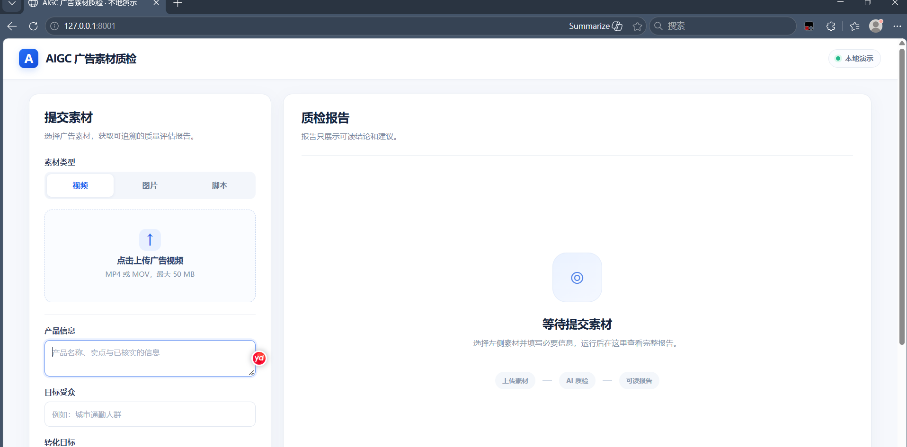

# AI Ad QA Video Processor

## AIGC 多模态内容质检 V1

本项目包含本地 Dify 工作流、视频处理服务和作品集演示页。工作流按视频、图片、脚本三类素材路由，输出结构化评估和人类可读 Markdown 报告。演示页只展示报告及最终状态，不展示排障 JSON。

### 本地演示页



上图展示输入界面和等待提交状态；真实质检结果需提交素材后查看。

1. 启动 Docker Desktop 和本地 Dify，确认多模态质检工作流已发布。
2. 双击 `启动FastAPI.cmd`，确认 `http://localhost:8000/health` 正常。
3. 双击 `启动演示页.cmd`，在弹出的终端中输入该 Dify 工作流的 **应用 API Key**。输入不回显；密钥仅保存在当前演示服务进程的环境变量中。不要把密钥写进仓库、`.env` 或浏览器。
4. 打开 `http://127.0.0.1:8001`，选择视频、图片或脚本提交素材。关闭演示页终端即可结束服务。

演示服务仅监听本机 `127.0.0.1:8001`。`localhost` 地址不能直接分享给其他电脑；别人可克隆仓库，在自己的 Dify 中导入 DSL、配置模型和应用 API Key 后本地运行。视频最大 50 MB，图片最大 10 MB；脚本直接输入文字。视频运行可能较久，页面会显示等待时间。

首次运行需要本项目 `.venv` 已由 `启动FastAPI.cmd` 创建。演示页只负责呈现，不改变现有 Dify DSL 或视频处理 API。

- 候选 DSL：`workflow/candidate/AIGC-Multimodal-QA-v1.yml`
- 确定性生成器：`workflow/tools/build_multimodal_v1.py`
- 公开测试素材：`tests/fixtures/multimodal/`
- 验证边界：`docs/multimodal-v1-validation.md`

当前 `workflow/current/` 与多模态候选 DSL 分开管理；Dify 中的发布状态和各素材实测记录见 `docs/multimodal-v1-validation.md`。本地演示页的模拟接口测试不等同于三类素材通过演示页的真实端到端测试。

Local FastAPI service used by the Dify workflow to extract fixed-time JPEG
frames from uploaded MP4 and MOV advertising videos.

## Start

On Windows, the easiest option is to double-click:

- `启动FastAPI.cmd` — start the service and keep its window open.
- `检查FastAPI状态.cmd` — verify `http://localhost:8000/health`.
- `停止FastAPI.cmd` — stop only this project's Uvicorn process.

The first start creates the project-local `.venv`, installs missing packages
there, checks the portable FFmpeg executables, and creates
`E:\AI\Data\AI-Ad-QA\video_processor_data`.

Portable FFmpeg is expected at `E:\AI\Tools\ffmpeg`. The launcher references
the executables directly and does not modify the Windows system `PATH`.

The equivalent PowerShell command is:

```powershell
powershell -ExecutionPolicy Bypass -File .\start_video_processor.ps1
```

The service listens on `0.0.0.0:8000`.

- Windows health check: `http://localhost:8000/health`
- Dify URL: `http://host.docker.internal:8000/api/v1/videos/extract`
- API documentation: `http://localhost:8000/docs`

## API

Upload a video as multipart form data with the field name `video`:

```powershell
curl.exe -X POST `
  -F "video=@C:\path\to\video.mp4" `
  http://localhost:8000/api/v1/videos/extract
```

Generated data is stored under
`E:\AI\Data\AI-Ad-QA\video_processor_data\<video_id>`.

Runtime safeguards:

- Maximum upload size: 500 MiB.
- FFmpeg and FFprobe calls have explicit timeouts.
- Successfully processed source videos are removed; extracted JPEG frames are
  retained for Dify access.
- UUID task directories older than 7 days are removed on startup. Unrelated
  directories are not touched.
- `/health` returns success only when FFmpeg and FFprobe are usable.

## Personal PC and GitHub

Use a private GitHub repository. Do not commit `.env` files, model API keys,
uploaded videos, extracted frames, runtime outputs, or virtual environments.

After cloning on another Windows PC:

1. Install Python 3.11 or newer and place portable FFmpeg under
   `E:\AI\Tools\ffmpeg`.
2. Start Docker Desktop and wait for Dify.
3. Double-click `启动FastAPI.cmd`.
4. Import the current workflow DSL into Dify and configure model credentials.

FastAPI source updates can be applied with `git pull` and a service restart.
Dify workflow DSL updates are versioned in Git but must still be imported into
Dify manually.

### First GitHub push

Create a **Private** GitHub repository named `ai-ad-qa-automation` under
`shawking66666-bit`, then double-click `Push-to-GitHub.cmd`. The script uses
repository-local Git identity settings:

- User: `shawking66666-bit`
- Email: `272393408+shawking66666-bit@users.noreply.github.com`

It does not change the company's global Git configuration.

## Test

```powershell
.\.venv\Scripts\python.exe -m unittest discover -s tests -v
```
